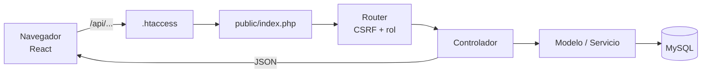

<div align="center">


# CopiwayPRO

**Sistema de gestión para una dark kitchen de hamburguesas a domicilio**

Menú y pedidos en línea · Tablero de cocina · Reparto con mapa · Inventario · Cierre de caja

<br>


[Características](#-características) ·
[Tecnologías](#-tecnologías) ·
[Instalación](#-instalación) ·
[Arquitectura](#-arquitectura) ·
[Documentación](#-documentación)

</div>

---

## 📋 Acerca del proyecto

**CopiwayPRO** administra de punta a punta el negocio de **Hamburguer Copiway**, una cocina que solo vende a domicilio. Cada persona entra con su rol y ve únicamente las pantallas que necesita:

| Rol | Qué hace |
|---|---|
| 🧑 **Cliente** | Ve el menú, arma su hamburguesa, paga y sigue su pedido en tiempo real. |
| 👨‍🍳 **Ayudante de Cocina** | Recibe los pedidos en un tablero y los marca como preparados. |
| 🛵 **Domiciliario** | Toma pedidos, ve la ruta en el mapa y confirma la entrega con un PIN. |
| 🧑‍💼 **Administrador** | Controla menú, inventario, personal, ajustes del negocio y cierre de caja. |
| 💻 **Programador** | Acceso técnico completo para soporte y mantenimiento. |

## ✨ Características

- **Pedidos en línea** — carrito, personalización de ingredientes, creador interactivo de hamburguesas y recompra en un clic.
- **Pedido manual** — el administrador registra pedidos por llamada o WhatsApp, incluso para personas sin cuenta.
- **Pagos** — efectivo o digital (Nequi, Daviplata, Bancolombia) con transacciones firmadas.
- **Tablero de cocina** — columnas *Pendientes → En preparación → Listos*, alerta sonora e impresión de comanda.
- **Reparto** — mapa con la ruta (Leaflet), contacto por WhatsApp y entrega validada con **PIN de 4 dígitos**.
- **Inventario** — descuento automático de insumos por venta e historial de movimientos.
- **Fidelización** — puntos canjeables al pagar y 15 % de descuento el día del cumpleaños.
- **Panel administrativo** — gráficas de ventas, horario, tarifa de domicilio, margen de ganancia y pausa de emergencia.
- **Cierre de caja** — ventas en efectivo vs. digital, liquidación por domiciliario, consumo de insumos y reporte en PDF.
- **Notificaciones push y correo** — implementadas en PHP puro, sin librerías externas.
- **Seguridad** — consultas preparadas, token CSRF, control de acceso por rol y límite de intentos de inicio de sesión.

## 🛠 Tecnologías

| Capa | Tecnología |
|---|---|
| **Frontend** | React 19, TypeScript, Tailwind CSS 4, Vite 6, Zustand, Leaflet, Recharts, jsPDF |
| **Backend** | PHP 8 sin framework, patrón **MVC**, API REST con respuestas JSON |
| **Base de datos** | MySQL 8 (MySQLi con consultas preparadas) |
| **Entorno local** | Laragon (Apache + PHP + MySQL) |

## 🚀 Instalación

### Requisitos

- [Laragon](https://laragon.org/) con PHP 8 y MySQL 8
- [Node.js](https://nodejs.org/) 18 o superior

### Pasos

**1. Clonar el repositorio** dentro de la carpeta `www` de Laragon:

```bash
cd C:\laragon\www
git clone https://github.com/aescorciaroa-hash/copiwaypro.git
cd copiwaypro
```

**2. Crear la base de datos** (desde HeidiSQL, phpMyAdmin o la consola):

```powershell
mysql -u root --default-character-set=utf8mb4 < sql\schema.sql
```

> [!WARNING]
> `schema.sql` elimina la base de datos si ya existe.

**3. Crear el primer administrador:**

```bash
php sql\create-admin.php
```

**4. Compilar el frontend:**

```bash
npm install
npm run build
```

**5. Abrir el sitio** con Apache y MySQL encendidos en Laragon:

```
http://localhost/copiwaypro/
```

> [!TIP]
> La conexión se configura en `config/database.php`. Con Laragon por defecto (usuario `root` sin contraseña) no hay que cambiar nada.

### Modo desarrollo

```bash
npm run dev
```

Abre Vite en `http://localhost:3000` con recarga automática y reenvía `/api/*` al Apache de Laragon. Para elegir la pantalla usa `?pagina=admin` en la dirección.

## 🏗 Arquitectura

React dibuja las pantallas y le pide los datos a PHP; PHP los consulta en MySQL y responde en JSON.



### Estructura de carpetas

```
copiwaypro/
├── config/        Conexión, ajustes, rutas de la API y de páginas, sesión y router
├── controllers/   Un controlador por recurso (productos, pedidos, personal...)
├── models/        Un modelo por tabla y los servicios de negocio (pedidos, caja, pagos, correo, push)
├── views/         Plantillas PHP que cargan React y conversores a JSON
├── public/        Punto de entrada único (index.php) y frontend compilado
├── sql/           Esquema de la base de datos y creación del primer administrador
├── src/           Código fuente del frontend en React + TypeScript
└── Document/      Documentación completa del proyecto
```

<details>
<summary><b>🔌 Endpoints principales de la API</b></summary>

<br>

Las rutas que modifican datos exigen el token CSRF (`X-CSRF-Token`); las rutas protegidas exigen sesión y rol.

| Recurso | Endpoints |
|---|---|
| Autenticación | `POST /api/auth/login` · `register` · `logout` · `forgot-password/*` · `GET /api/auth/csrf` |
| Productos | `POST` `PUT` `DELETE /api/products` · `POST /api/uploads/product-image` |
| Inventario | `POST` `PUT` `DELETE /api/inventory` · `PATCH /api/inventory/{id}/stock` |
| Pedidos | `GET` `POST /api/orders` · `POST /api/orders/manual` · `PATCH /api/orders/{id}/{estado}` |
| Pagos | `POST /api/payments/prepare` · `POST` `GET /api/payments/transactions` |
| Personal y clientes | `/api/staff` · `/api/clients/{id}` |
| Ajustes | `PUT /api/settings` · `/api/settings/categories` |
| Cierre de caja | `GET /api/cash-closing/preview` · `POST /api/cash-closing` |
| Notificaciones | `GET /api/push/public-key` · `POST /api/push/subscribe` |
| Sincronización | `GET /api/sync` — todos los datos de la pantalla (responde `304` si nada cambió) |

La lista completa con controladores y roles está en [`config/rutas.php`](config/rutas.php).

</details>

## ⚙️ Configuración

| Qué | Dónde |
|---|---|
| Conexión a MySQL | `config/database.php` |
| Entorno, modo debug, zona horaria y carpeta base | `config/app.php` |
| Nombre y duración de la sesión | `config/Session.php` |
| Intentos de inicio de sesión | `models/IntentoLogin.php` |
| Clave de firma de pagos | `CLAVE_FIRMA` en `models/PagoService.php` |
| Claves de notificaciones push | `VAPID_*` en `models/PushNotificationService.php` |
| Servidor de correo (SMTP) | `models/CorreoService.php` |
| Horario, tarifa, puntos y datos del negocio | Panel del administrador |

## 🔒 Antes de publicar en producción

- [ ] En `config/app.php`: `'debug' => false` y `'entorno' => 'production'`.
- [ ] Reemplazar `CLAVE_FIRMA` por un texto largo y aleatorio.
- [ ] Servir el sitio por **HTTPS** (las cookies de sesión se marcan `secure` automáticamente).

## 📚 Documentación

| Guía | Contenido |
|---|---|
| [Guías generales](Document/Documentacion.md/GuiasDelProyecto/General/README.md) | Instalación, funcionamiento, roles, pedidos, seguridad y problemas comunes |
| [Estructura y glosario](Document/Documentacion.md/GuiasDelProyecto/Estructura&Glosario/ESTRUCTURA.md) | Árbol completo del proyecto y términos técnicos |
| [Documentación por archivo](Document/Documentacion.md/README.md) | Qué hace cada archivo, con qué se conecta y para qué sirve cada variable |

---

<div align="center">

Hecho para **Hamburguer Copiway** 🍔

</div>
